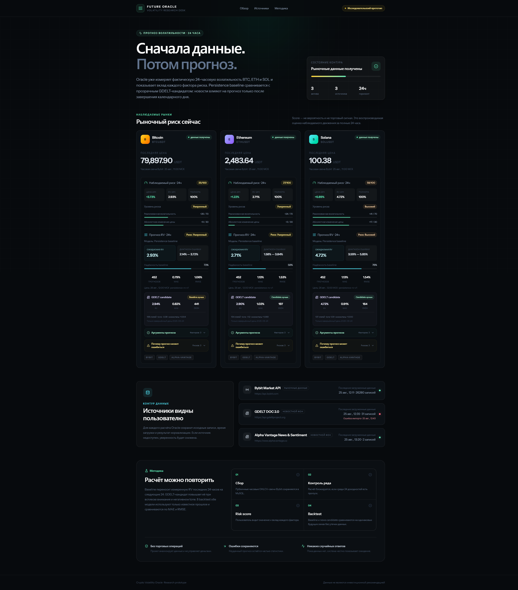
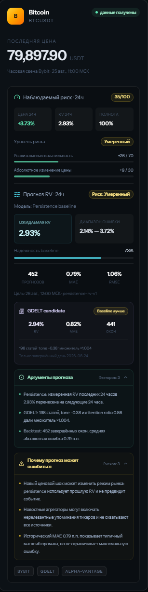
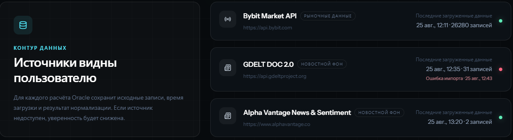
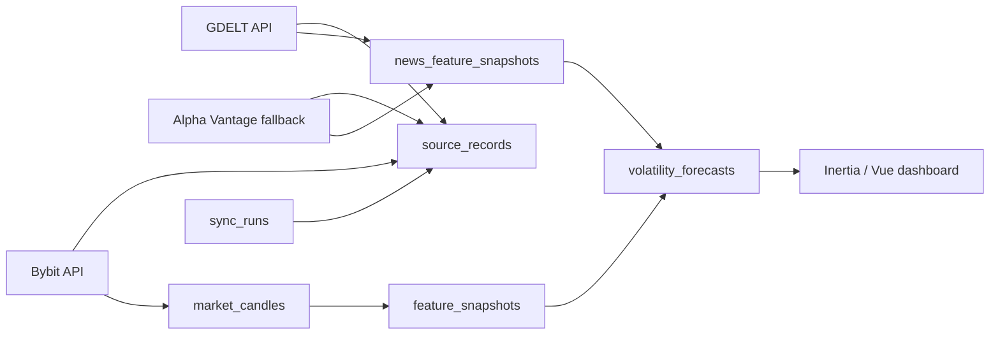

# Crypto Volatility Oracle

Прототип **Future Oracle**, который прогнозирует реализованную волатильность BTC, ETH и SOL на следующие 24 часа. Система использует реальные рыночные данные Bybit, новостные показатели GDELT и резервный Alpha Vantage, сохраняет исходные записи и показывает, из каких чисел получился прогноз.

> Это исследовательский прототип, а не финансовая рекомендация. В проекте нет торговли, подключения кошельков, реальных денег или обещаний доходности.

## Скриншоты

### Dashboard



### Детали прогноза



### Источники данных



## Основной сценарий

1. Пользователь открывает публичный dashboard.
2. Выбирает карточку BTC, ETH или SOL.
3. Видит текущую цену, изменение за 24 часа, реализованную волатильность и полноту данных.
4. Получает прогноз волатильности на следующие 24 часа, confidence, диапазон ошибки и уровень риска.
5. Видит аргументы прогноза, использованные показатели Bybit/GDELT и причины, по которым прогноз может не сработать.
6. Сравнивает persistence baseline с news-adjusted candidate по MAE и RMSE.

## Что реализовано

- адаптивный dashboard на Vue и Inertia;
- три объекта прогноза: `BTCUSDT`, `ETHUSDT`, `SOLUSDT`;
- загрузка часовых свечей из публичного Bybit API;
- загрузка дневных рядов объёма упоминаний и average tone из GDELT DOC 2.0;
- автоматический fallback на Alpha Vantage News & Sentiment при недоступности GDELT;
- хранение источников, исходных записей, нормализованных показателей, прогнозов и истории синхронизаций;
- идемпотентный импорт через стабильные provider keys и `upsert`;
- прозрачный baseline и отдельная новостная модель-кандидат;
- backtest по завершённым 24-часовым окнам;
- confidence, риск, аргументы и причины возможной ошибки;
- планировщик регулярного обновления;
- feature-тесты внешних интеграций через HTTP fakes.

## Стек

- PHP 8.4, Laravel 13;
- MySQL 8.0 в локальном окружении, SQLite для быстрого старта и тестов;
- Vue 3, TypeScript, Inertia 3;
- Tailwind CSS 4, Lucide icons;
- Pest, PHPStan, Laravel Pint, ESLint, Prettier;
- Vite.

## Источники данных

### Bybit Market API

Публичные часовые OHLCV-свечи. Для каждой точки сохраняются symbol, interval, timestamp, open, high, low, close, volume и turnover.

- API: <https://api.bybit.com>
- Авторизация не требуется.

### GDELT DOC 2.0

Дневные временные ряды:

- `TimelineVolRaw` — число упоминаний и общий объём отслеживаемых материалов;
- `TimelineTone` — средний эмоциональный tone публикаций.

- API: <https://api.gdeltproject.org/api/v2/doc/doc>
- Авторизация не требуется.
- Публичный API ограничивает частоту запросов, поэтому между запросами есть настраиваемая пауза и retry.

AI не используется для придумывания или изменения входных данных.

### Alpha Vantage News & Sentiment

Резервный источник возвращает реальные статьи и рассчитанный провайдером sentiment для конкретной криптовалюты. Проект сохраняет полный payload статьи, а затем считает по каждому дню число релевантных статей и средний ticker sentiment, взвешенный на relevance.

- API: <https://www.alphavantage.co/documentation/#news-sentiment>
- Нужен бесплатный `ALPHA_VANTAGE_API_KEY`.
- Бесплатный тариф: 25 запросов в день; одного ежедневного fallback-запуска для трёх активов достаточно. Alpha Vantage вызывается без автоматических HTTP-retry, чтобы один сбой не расходовал несколько запросов.
- Ключ хранится только в локальном `.env` и не выводится в логи или интерфейс.

## Как устроен поток данных



## Алгоритм прогноза

### 1. Рыночные признаки

Для полного окна нужны 25 последовательных часовых свечей и 24 доходности:

```text
r_t = ln(close_t / close_t-1)
RV_24h = sqrt(sum(r_t²)) × 100
change_24h = (last_close / first_close - 1) × 100
```

Если в окне есть пропуск, система показывает полноту ряда, но не выдаёт рассчитанный score как достоверный.

Рыночный risk score состоит из двух объяснимых частей:

```text
volatility contribution = min(70, RV_24h / 8 × 70)
price move contribution = min(30, abs(change_24h) / 12 × 30)
risk score = min(100, volatility contribution + price move contribution)
```

### 2. Persistence baseline

Простая проверяемая гипотеза:

```text
forecast RV for next 24h = observed RV for previous 24h
```

Baseline выбран намеренно: он понятен, воспроизводим и даёт честную точку сравнения для более сложной модели.

### 3. News-adjusted candidate

Для прогноза используется только последний полностью завершённый день, то есть данные будущего не попадают в модель. Сначала система ищет согласованное окно GDELT; если его нет, использует только Alpha Vantage для текущего и предыдущих дней, не смешивая шкалы провайдеров.

```text
attention ratio = current coverage share / average coverage share for previous 7 days
attention shock = clamp(attention ratio - 1, 0, 2)
negative tone shock = clamp(-average tone / 10, 0, 1)
multiplier = min(1.4, 1 + 0.15 × attention shock + 0.10 × negative tone shock)
candidate forecast = baseline forecast × multiplier
```

Для GDELT attention строится из `coverage_share_pct`, а для Alpha Vantage — из числа релевантных статей. Tone GDELT имеет широкую шкалу и нормализуется делением на 10; ticker sentiment Alpha Vantage уже находится примерно в диапазоне от -1 до 1. Фактически выбранный провайдер и метрика сохраняются в `model_inputs`.

Новостная модель может увеличить прогноз максимум на 40%. Все её входы и итоговый multiplier сохраняются в `model_inputs`.

### 4. Confidence и диапазон ошибки

Когда для прогнозного окна появились будущие свечи, система рассчитывает фактическую RV и ошибки:

```text
absolute error = abs(predicted RV - actual RV)
squared error = absolute error²
MAE = average absolute error
RMSE = sqrt(average squared error)
confidence = clamp(100 - MAE / max(predicted RV, 0.5) × 100, 10, 95)
error range = max(0, predicted RV - MAE) ... predicted RV + MAE
```

Так система понимает, что ошиблась: прогноз переводится из `pending` в `evaluated`, рядом сохраняются фактическое значение, абсолютная и квадратичная ошибки. Candidate сравнивается с baseline только на накопленной истории; для содержательного вердикта требуется не менее 30 завершённых окон.

## Где хранятся данные

| Таблица | Назначение |
| --- | --- |
| `assets` | Активы, по которым строится прогноз |
| `data_sources` | Справочник реальных источников |
| `asset_source_mappings` | Символы и запросы конкретного провайдера |
| `sync_runs` | История запусков, статусы, счётчики и ошибки |
| `source_records` | Исходные точки провайдера, payload, checksum и связь с sync run |
| `market_candles` | Нормализованные часовые OHLCV-свечи |
| `news_feature_snapshots` | Нормализованные дневные показатели GDELT и Alpha Vantage |
| `feature_snapshots` | Рассчитанные рыночные признаки |
| `volatility_forecasts` | Прогнозы, model inputs, confidence и результаты оценки |

Исходные записи не используются как случайный генератор: нормализованные показатели и прогнозы однозначно рассчитываются из сохранённых чисел.

## Локальный запуск

### Требования

- PHP 8.3 или новее;
- Composer;
- Node.js и npm;
- SQLite либо MySQL 8.0.

### Установка

```bash
composer install
cp .env.example .env
php artisan key:generate
```

По умолчанию `.env.example` использует SQLite. Создайте пустой файл `database/database.sqlite`, затем выполните:

```bash
php artisan migrate --seed
npm install
npm run build
php artisan serve
```

Чтобы сразу получить заполненный dashboard без доступа к внешним API, загрузите включённый demo-набор:

```bash
php artisan oracle:load-demo
```

Команда идемпотентно импортирует реальные сохранённые данные и автоматически строит обе модели прогноза.

Для разработки frontend можно использовать:

```bash
npm run dev
```

При использовании Laravel Herd достаточно создать сайт из папки проекта и открыть выданный Herd-домен.

### MySQL

Чтобы использовать MySQL, измените только локальный `.env`:

```dotenv
DB_CONNECTION=mysql
DB_HOST=127.0.0.1
DB_PORT=3306
DB_DATABASE=crypto_volatility_oracle
DB_USERNAME=your_user
DB_PASSWORD=your_password
```

Секреты и реальные пароли не должны попадать в Git.

Для резервных новостей добавьте полученный бесплатный ключ:

```dotenv
ALPHA_VANTAGE_API_KEY=your_key
```

## Загрузка данных и построение прогнозов

### Быстрый offline demo

Файл `database/fixtures/oracle-demo.json` содержит переносимый срез реальных публичных данных за 45 дней:

- raw payloads Bybit, GDELT и Alpha Vantage;
- нормализованные часовые свечи;
- дневные показатели новостного внимания и tone;
- метаданные диапазона, происхождения и количества записей.

В файле нет `.env`, паролей или API-ключей. Внутренние ID базы не экспортируются: загрузчик связывает записи по `asset_symbol` и `source_key`, поэтому один JSON работает с MySQL и SQLite.

```bash
php artisan migrate --seed
php artisan oracle:load-demo
```

Повторный запуск не дублирует свечи, новости, raw-записи или историю загрузки этого fixture. Для воспроизводимости JSON можно пересоздать из локальной базы:

```bash
php artisan oracle:export-demo --days=45
```

### Свежие данные из API

Первичное заполнение:

```bash
php artisan oracle:backfill-bybit --days=90
php artisan oracle:sync-news --days=8
php artisan oracle:build-baseline
php artisan oracle:build-news-model
```

Быстрое обновление последних свечей:

```bash
php artisan oracle:sync-bybit --limit=200
```

Команды поддерживают повторный запуск и фильтр `--symbol`. Например:

```bash
php artisan oracle:sync-bybit --symbol=BTCUSDT
php artisan oracle:sync-alpha-vantage --days=8 --symbol=ETHUSDT
php artisan oracle:build-baseline --symbol=BTCUSDT
```

`oracle:sync-news` сначала вызывает GDELT и переключается на Alpha Vantage только при ошибке. Команды обоих провайдеров поддерживают `--end-date=YYYY-MM-DD` для исторических окон. Ежедневное окно ограничено 8 днями, а Alpha Vantage возвращает до 200 самых свежих статей: этого достаточно для текущего 7-дневного attention baseline и ограничивает размер ответа. Большие исторические периоды лучше загружать отдельными окнами.

Для автоматического обновления:

```bash
php artisan schedule:work
```

Расписание:

- Bybit — каждый час;
- baseline — каждый час после обновления рынка;
- новости — раз в сутки: GDELT как основной источник, Alpha Vantage как fallback;
- news-adjusted candidate — раз в сутки после обновления новостей.

## Проверка проекта

```bash
php artisan test --compact
php -d memory_limit=512M vendor/bin/phpstan analyse --no-progress
npm run types:check
npm run lint:check
npm run format:check
npm run build
```

На момент подготовки README полный набор содержит 66 автоматических тестов и 455 assertions.

## Как использовался AI

В разработке использовался OpenAI Codex как инженерный помощник:

- декомпозиция задания и обсуждение архитектуры;
- подготовка части Laravel/Vue boilerplate;
- поиск граничных случаев в импорте и расчётах;
- генерация и расширение тестовых сценариев;
- проверка типов, статического анализа и production-сборки;
- помощь в формулировке документации.

Все ключевые решения проверялись по коду, сохранённым данным и тестам. AI не вызывается приложением в runtime и не генерирует прогнозы: результат считается детерминированным PHP-кодом по данным Bybit, GDELT и резервного Alpha Vantage.

## Ограничения прототипа

- прогнозируется волатильность, а не направление и не доходность цены;
- persistence не умеет предвидеть новый рыночный шок;
- GDELT может содержать нерелевантные упоминания и имеет строгий rate limit;
- простое правило tone/attention не заменяет обученную и валидированную ML-модель;
- MAE описывает типичную историческую ошибку, но не гарантирует максимальную границу;
- текущий backtest — демонстрационный, без walk-forward оптимизации и комиссий;
- проект не предназначен для принятия реальных инвестиционных решений.

## Возможные следующие шаги

- добавить график фактической и предсказанной RV во времени;
- сделать страницу отдельного прогноза с drill-down до raw source records;
- добавить walk-forward validation и сравнение с EWMA/GARCH;
- улучшить фильтрацию новостей и выделение событий;
- добавить мониторинг качества источников и алерты по деградации модели.
